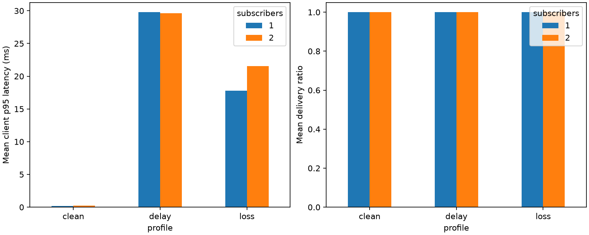

# MoQStreamLab

A bounded media delivery experiment using Rust, Tokio and the moq-dev native QUIC stack. The publisher serves a named video track directly to subscribers. Each independently decodable FFmpeg JPEG is one frame in its own MoQ group, with an application sequence number, sender timestamp and SHA-256 payload digest. Subscribers validate the envelope and media boundaries and record application delivery times.

## Protocol and scope

The pinned transport libraries are `moq-lite 0.14.0` and `moq-native 0.13.0`. This implementation uses their MoQ Lite dialect over WebTransport/QUIC, with the Quinn backend. WebSocket fallback is disabled at compile time. The object envelope is local to this lab, so another media player would need the same JPEG track framing. Current IETF draft interoperability and browser playback are outside the measured experiment.

The publisher is also the server, removing the need for a relay in a one-to-many experiment. Each subscriber has its own QUIC connection. Up to eight sessions are accepted. The tool defaults to loopback and the lab generates a private test CA and server certificate. Subscribers verify that certificate against the explicitly supplied CA. The service has no user authentication, so keep the experiment local or in an isolated network.

## Reproduce on Linux

Install stable Rust, Python 3.11+, FFmpeg and OpenSSL.

```sh
python -m pip install -r requirements.txt
cargo test
cargo build --release
python -m pytest -q
python lab.py
python analyze.py
```

The default lab runs three repetitions of one and two subscribers under an unmodified localhost network. To add repeatable delay and packet-loss profiles on an **isolated Linux runner**, use:

```sh
python lab.py --netem
python analyze.py
```

The network experiment temporarily configures the runner's loopback qdisc with `sudo tc`. It removes its qdisc in the cleanup block. Keep that mode on a disposable runner where no pre-existing loopback qdisc must be preserved. Each run writes to a fresh directory and refuses to merge with previous measurements. Use `--work work-second` for a repeat.

GitHub Actions compiles and tests Rust, checks Python metrics, runs all network profiles, and saves measurement logs and aggregate reports as artifacts. Docker supports the clean experiment through `docker build -t moqstreamlab .` and `docker run --rm moqstreamlab`. The Docker process prints the report. Mount a host directory at `/lab/results` to retain outputs.

## Manual publisher and subscriber

After the lab prepares the sample frames and certificates:

```sh
target/release/moqstreamlab publish --frames work/frames --cert work/server.pem --key work/server.key --count 120
target/release/moqstreamlab subscribe --ca work/ca.pem --out subscriber.jsonl --count 120
```

The publisher waits 2.5 seconds before producing media so clients can subscribe. Both programs accept `--track`. The frame count, track name, frame size and timeouts have explicit bounds. The subscriber refuses to overwrite an existing output file. No reconnect loop hides a connection failure. A timeout returns a failed exit status and retains the partial measurement log.

## Verified results

The hosted Linux run delivered **2,430 of 2,430 JPEG objects** across 18 publisher runs and 27 subscriber logs. All subscriber processes exited successfully. No receive gap exceeded the configured 100 ms interruption threshold. The separate Docker clean-network experiment also passed.

| Loopback profile | Subscribers | Mean subscriber p95 delivery latency | Mean payload goodput |
| --- | ---: | ---: | ---: |
| Clean | 1 | 0.164 ms | 0.944 Mbps |
| Clean | 2 | 0.230 ms | 0.944 Mbps |
| 25 ± 5 ms added delay | 1 | 29.783 ms | 0.945 Mbps |
| 25 ± 5 ms added delay | 2 | 29.612 ms | 0.945 Mbps |
| 15 ± 3 ms delay with 1% packet loss | 1 | 17.784 ms | 0.946 Mbps |
| 15 ± 3 ms delay with 1% packet loss | 2 | 21.527 ms | 0.942 Mbps |

Each cell averages three publisher repetitions, including each subscriber separately. The full delivery ratio under 1% packet loss describes this workload over a reliable QUIC transport. It does not establish a general loss-free live-media guarantee. Startup delay ranged from about 2.50 to 2.53 seconds, dominated by the deliberate 2.5-second publisher lead-in.

[Raw per-subscriber metrics](results/summary.json) · [Aggregated metrics](results/averages.csv) · [Passing verification](https://github.com/TNSPRADYUMNA/moqstreamlab/actions/runs/45358164442)



## Metric interpretation

- **Application delivery latency** is receiver wall-clock time minus the timestamp immediately before publication. Both processes use the same host clock in this benchmark.
- **Startup delay** runs from subscriber process setup to its first delivered object. It includes the deliberate publisher lead-in.
- **Payload goodput** divides JPEG bytes received after the first object by elapsed receiver time between first and last arrivals. It excludes transport overhead.
- **Interruption count** counts receive gaps above the larger of 100 ms and three configured frame intervals. Missing-object count is reported independently through delivery ratio.
- **Integrity** is verified by sequence uniqueness, envelope length, JPEG markers and SHA-256. The checksum complements QUIC's transport protection.

The experiment uses synthetic 160×90 motion frames at a nominal 33 ms interval. It measures transport delivery, with no decoder/playout buffer or audio synchronization. Repeat measurements on representative devices and networks before drawing deployment conclusions.

## Upstream dependencies

The transport follows the documented APIs of [moq-dev](https://github.com/moq-dev/moq). Its published protocol and native library define the wire behavior. The repository's application envelope, process harness, metrics and reports are specific to MoQStreamLab.
